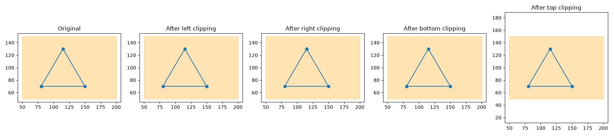
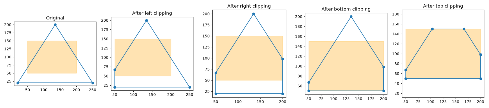
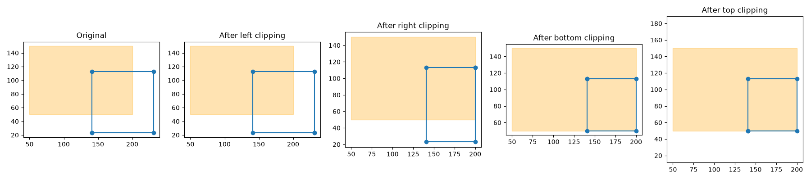

# Sutherland–Hodgman Polygon Clipping

## **Aim**

To implement the Sutherland–Hodgman polygon clipping algorithm in Python, and to clip a given set of polygons  against a given rectangular window.

### Input

**Clipping window:** lower-left corner $(50, 50)$, upper-right corner $(200, 150)$ — the same window as in the previous  assignment.

Clip each of the following three polygons against this window. The vertices are listed in order around the  polygon.

**Input Polygons:**

_Own Polygon_: roll 213, so a=1, b=3

| Polygon | Vertices, in order |
| --- | ----- |
| Q1 | $(80, 70),\ (150, 70),\ (115, 130)$ |
| Q2 | $(20, 20),\ (250, 20),\ (135, 200)$ |
| Q3 | $(140 + 1, 20 + 3),\ (230 + 1, 20 + 3),\ (230 + 1, 110 +3),\ (140 + 1, 110 +3)$ |

### Output

#### Output for Polygon Q1

$(80, 70),\ (150, 70),\ (115, 130)$

```py
Processing polygon Q1
After left clipping:
Polygon(
 vertices = [(150,70), (115,130), (80,70)], 
 edges = [Edge:(150,70)->(115,130), Edge:(115,130)->(80,70), Edge:(80,70)->(150,70)]
)
After right clipping:
Polygon(
 vertices = [(115,130), (80,70), (150,70)], 
 edges = [Edge:(115,130)->(80,70), Edge:(80,70)->(150,70), Edge:(150,70)->(115,130)]
)
After bottom clipping:
Polygon(
 vertices = [(80,70), (150,70), (115,130)], 
 edges = [Edge:(80,70)->(150,70), Edge:(150,70)->(115,130), Edge:(115,130)->(80,70)]
)
After top clipping:
Polygon(
 vertices = [(150,70), (115,130), (80,70)], 
 edges = [Edge:(150,70)->(115,130), Edge:(115,130)->(80,70), Edge:(80,70)->(150,70)]
)
```



\newpage

#### Output for Polygon Q2

$(20, 20),\ (250, 20),\ (135, 200)$

```py
Processing polygon Q2
After left clipping:
Polygon(
 vertices = [(50,20), (250,20), (135,200), (50,66.9565)], 
 edges = [Edge:(50,20)->(250,20), Edge:(250,20)->(135,200), Edge:(135,200)->(50,66.9565), Edge:(50,66.9565)->(50,20)]
)
After right clipping:
Polygon(
 vertices = [(200,20), (200,98.2609), (135,200), (50,66.9565), (50,20)], 
 edges = [Edge:(200,20)->(200,98.2609), Edge:(200,98.2609)->(135,200), Edge:(135,200)->(50,66.9565), Edge:(50,66.9565)->(50,20), Edge:(50,20)->(200,20)]
)
After bottom clipping:
Polygon(
 vertices = [(200,50), (200,98.2609), (135,200), (50,66.9565), (50,50)], 
 edges = [Edge:(200,50)->(200,98.2609), Edge:(200,98.2609)->(135,200), Edge:(135,200)->(50,66.9565), Edge:(50,66.9565)->(50,50), Edge:(50,50)->(200,50)]
)
After top clipping:
Polygon(
 vertices = [(200,98.2609), (166.944,150), (103.056,150), (50,66.9565), (50,50), (200,50)], 
 edges = [Edge:(200,98.2609)->(166.944,150), Edge:(166.944,150)->(103.056,150), Edge:(103.056,150)->(50,66.9565), Edge:(50,66.9565)->(50,50), Edge:(50,50)->(200,50), Edge:(200,50)->(200,98.2609)]
)
```



\newpage

#### Output for Polygon Q3  

$(140 + 1, 20 + 3),\ (230 + 1, 20 + 3),\ (230 + 1, 110 +3),\ (140 + 1, 110 +3)$

```py
Processing polygon Q3
After left clipping:
Polygon(
 vertices = [(231,23), (231,113), (141,113), (141,23)], 
 edges = [Edge:(231,23)->(231,113), Edge:(231,113)->(141,113), Edge:(141,113)->(141,23), Edge:(141,23)->(231,23)]
)
After right clipping:
Polygon(
 vertices = [(200,113), (141,113), (141,23), (200,23)], 
 edges = [Edge:(200,113)->(141,113), Edge:(141,113)->(141,23), Edge:(141,23)->(200,23), Edge:(200,23)->(200,113)]
)
After bottom clipping:
Polygon(
 vertices = [(141,113), (141,50), (200,50), (200,113)], 
 edges = [Edge:(141,113)->(141,50), Edge:(141,50)->(200,50), Edge:(200,50)->(200,113), Edge:(200,113)->(141,113)]
)
After top clipping:
Polygon(
 vertices = [(141,50), (200,50), (200,113), (141,113)], 
 edges = [Edge:(141,50)->(200,50), Edge:(200,50)->(200,113), Edge:(200,113)->(141,113), Edge:(141,113)->(141,50)]
)
```



\newpage

### **Questions to Answer**

**1\. Which polygon came out of the algorithm unchanged? What was true of all of its vertices that made this  happen?**

The first polygon remain unchanged. all vertices pointa are inside.

**2\. Q2 goes in with 3 vertices and comes out with more. Write down the number of vertices after each of the  four stages, and explain where the extra vertices come from.**

input was 3 coordinate
after LEFT clip : 4 points  
after RIGHT clip : 5 points  
after BOTTOM clip : still 5 points, as the fig fits inside bottom boundary.  
after final TOP clip : 6 points

**3\. For your own polygon Q3, which boundaries of the window actually removed anything, and what are the  final clipped vertices?**

the LEFT and BOTTOM  boundery did the actual work.  
final clipped points are $[(141,50), (200,50), (200,113), (141,113)]$

**4\. For one edge of a polygon, going from the previous vertex to the current vertex, there are four possible  cases. List all four, and state what each case adds to the output list.**

- both start and end point in inside the window: no point updation
- both start and end point in outside the window: these points are removed
- start is outside end inside  
    in this case: new start become clip intersect point and end remain unchanged
- starts inside and ends outside  
    in this case: start is the new start point(no change) but the endpoint is the intersect point
