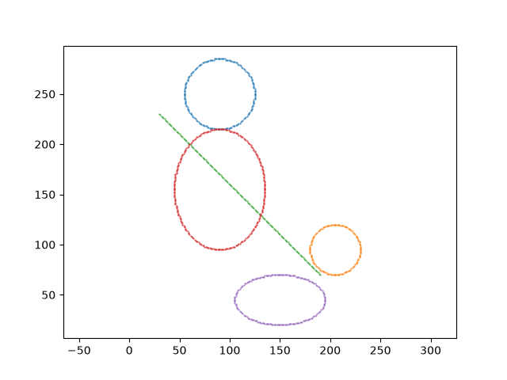
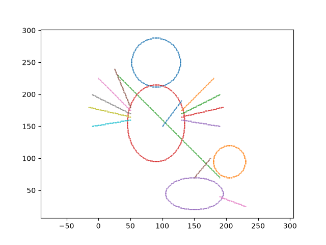

# Output  Analysis of Mix Drawing

## Output



### Generated Points

* **Generated points for:**  
|1|Durga's face|Midpoint circle|centre (90, 250), r = 35|

```txt
Circle 1 Points: 200

 (90,285), (90,285), (90,215), (90,215), (125,250), (55,250), (125,250), (55,250), (91,285), (89,285), (91,215), (89,215), (125,251), (55,251), (125,249), (55,249), (92,285), (88,285), (92,215), (88,215), (125,252), (55,252), (125,248), (55,248), (93,285), (87,285), (93,215), (87,215), (125,253), (55,253), (125,247), (55,247), (94,285), (86,285), (94,215), (86,215), (125,254), (55,254), (125,246), (55,246), (95,285), (85,285), (95,215), (85,215), (125,255), (55,255), (125,245), (55,245), (96,284), (84,284), (96,216), (84,216), (124,256), (56,256), (124,244), (56,244), (97,284), (83,284), (97,216), (83,216), (124,257), (56,257), (124,243), (56,243), (98,284), (82,284), (98,216), (82,216), (124,258), (56,258), (124,242), (56,242), (99,284), (81,284), (99,216), (81,216), (124,259), (56,259), (124,241), (56,241), (100,284), (80,284), (100,216), (80,216), (124,260), (56,260), (124,240), (56,240), (101,283), (79,283), (101,217), (79,217), (123,261), (57,261), (123,239), (57,239), (102,283), (78,283), (102,217), (78,217), (123,262), (57,262), (123,238), (57,238), (103,282), (77,282), (103,218), (77,218), (122,263), (58,263), (122,237), (58,237), (104,282), (76,282), (104,218), (76,218), (122,264), (58,264), (122,236), (58,236), (105,282), (75,282), (105,218), (75,218), (122,265), (58,265), (122,235), (58,235), (106,281), (74,281), (106,219), (74,219), (121,266), (59,266), (121,234), (59,234), (107,281), (73,281), (107,219), (73,219), (121,267), (59,267), (121,233), (59,233), (108,280), (72,280), (108,220), (72,220), (120,268), (60,268), (120,232), (60,232), (109,279), (71,279), (109,221), (71,221), (119,269), (61,269), (119,231), (61,231), (110,279), (70,279), (110,221), (70,221), (119,270), (61,270), (119,230), (61,230), (111,278), (69,278), (111,222), (69,222), (118,271), (62,271), (118,229), (62,229), (112,277), (68,277), (112,223), (68,223), (117,272), (63,272), (117,228), (63,228), (113,276), (67,276), (113,224), (67,224), (116,273), (64,273), (116,227), (64,227), (114,275), (66,275), (114,225), (66,225), (115,274), (65,274), (115,226), (65,226)

```

* **Generated points for:**  
|2|Durga's body|Midpoint ellipse|centre (90, 155), rx = 45, ry = 60|

```txt
Ellipse 1 Points: 304

 (90,215), (90,215), (90,95), (90,95), (91,215), (89,215), (91,95), (89,95), (92,215), (88,215), (92,95), (88,95), (93,215), (87,215), (93,95), (87,95), (94,215), (86,215), (94,95), (86,95), (95,215), (85,215), (95,95), (85,95), (96,214), (84,214), (96,96), (84,96), (97,214), (83,214), (97,96), (83,96), (98,214), (82,214), (98,96), (82,96), (99,214), (81,214), (99,96), (81,96), (100,213), (80,213), (100,97), (80,97), (101,213), (79,213), (101,97), (79,97), (102,213), (78,213), (102,97), (78,97), (103,212), (77,212), (103,98), (77,98), (104,212), (76,212), (104,98), (76,98), (105,212), (75,212), (105,98), (75,98), (106,211), (74,211), (106,99), (74,99), (107,211), (73,211), (107,99), (73,99), (108,210), (72,210), (108,100), (72,100), (109,209), (71,209), (109,101), (71,101), (110,209), (70,209), (110,101), (70,101), (111,208), (69,208), (111,102), (69,102), (112,207), (68,207), (112,103), (68,103), (113,207), (67,207), (113,103), (67,103), (114,206), (66,206), (114,104), (66,104), (115,205), (65,205), (115,105), (65,105), (116,204), (64,204), (116,106), (64,106), (117,203), (63,203), (117,107), (63,107), (118,202), (62,202), (118,108), (62,108), (119,201), (61,201), (119,109), (61,109), (120,200), (60,200), (120,110), (60,110), (121,199), (59,199), (121,111), (59,111), (121,198), (59,198), (121,112), (59,112), (122,197), (58,197), (122,113), (58,113), (123,196), (57,196), (123,114), (57,114), (124,195), (56,195), (124,115), (56,115), (124,194), (56,194), (124,116), (56,116), (125,193), (55,193), (125,117), (55,117), (125,192), (55,192), (125,118), (55,118), (126,191), (54,191), (126,119), (54,119), (127,190), (53,190), (127,120), (53,120), (127,189), (53,189), (127,121), (53,121), (128,188), (52,188), (128,122), (52,122), (128,187), (52,187), (128,123), (52,123), (129,186), (51,186), (129,124), (51,124), (129,185), (51,185), (129,125), (51,125), (129,184), (51,184), (129,126), (51,126), (130,183), (50,183), (130,127), (50,127), (130,182), (50,182), (130,128), (50,128), (131,181), (49,181), (131,129), (49,129), (131,180), (49,180), (131,130), (49,130), (131,179), (49,179), (131,131), (49,131), (132,178), (48,178), (132,132), (48,132), (132,177), (48,177), (132,133), (48,133), (132,176), (48,176), (132,134), (48,134), (132,175), (48,175), (132,135), (48,135), (133,174), (47,174), (133,136), (47,136), (133,173), (47,173), (133,137), (47,137), (133,172), (47,172), (133,138), (47,138), (133,171), (47,171), (133,139), (47,139), (134,170), (46,170), (134,140), (46,140), (134,169), (46,169), (134,141), (46,141), (134,168), (46,168), (134,142), (46,142), (134,167), (46,167), (134,143), (46,143), (134,166), (46,166), (134,144), (46,144), (134,165), (46,165), (134,145), (46,145), (134,164), (46,164), (134,146), (46,146), (135,163), (45,163), (135,147), (45,147), (135,162), (45,162), (135,148), (45,148), (135,161), (45,161), (135,149), (45,149), (135,160), (45,160), (135,150), (45,150), (135,159), (45,159), (135,151), (45,151), (135,158), (45,158), (135,152), (45,152), (135,157), (45,157), (135,153), (45,153), (135,156), (45,156), (135,154), (45,154), (135,155), (45,155), (135,155), (45,155)

```

* **Generated points for:**  
|3|Trishul (the stick)|Bresenham line|from (30, 230) to (190, 70)|

```txt
Line Points: 161

 (30,230), (31,229), (32,228), (33,227), (34,226), (35,225), (36,224), (37,223), (38,222), (39,221), (40,220), (41,219), (42,218), (43,217), (44,216), (45,215), (46,214), (47,213), (48,212), (49,211), (50,210), (51,209), (52,208), (53,207), (54,206), (55,205), (56,204), (57,203), (58,202), (59,201), (60,200), (61,199), (62,198), (63,197), (64,196), (65,195), (66,194), (67,193), (68,192), (69,191), (70,190), (71,189), (72,188), (73,187), (74,186), (75,185), (76,184), (77,183), (78,182), (79,181), (80,180), (81,179), (82,178), (83,177), (84,176), (85,175), (86,174), (87,173), (88,172), (89,171), (90,170), (91,169), (92,168), (93,167), (94,166), (95,165), (96,164), (97,163), (98,162), (99,161), (100,160), (101,159), (102,158), (103,157), (104,156), (105,155), (106,154), (107,153), (108,152), (109,151), (110,150), (111,149), (112,148), (113,147), (114,146), (115,145), (116,144), (117,143), (118,142), (119,141), (120,140), (121,139), (122,138), (123,137), (124,136), (125,135), (126,134), (127,133), (128,132), (129,131), (130,130), (131,129), (132,128), (133,127), (134,126), (135,125), (136,124), (137,123), (138,122), (139,121), (140,120), (141,119), (142,118), (143,117), (144,116), (145,115), (146,114), (147,113), (148,112), (149,111), (150,110), (151,109), (152,108), (153,107), (154,106), (155,105), (156,104), (157,103), (158,102), (159,101), (160,100), (161,99), (162,98), (163,97), (164,96), (165,95), (166,94), (167,93), (168,92), (169,91), (170,90), (171,89), (172,88), (173,87), (174,86), (175,85), (176,84), (177,83), (178,82), (179,81), (180,80), (181,79), (182,78), (183,77), (184,76), (185,75), (186,74), (187,73), (188,72), (189,71), (190,70)

```

* **Generated points for:**  
|4|Asur's face|Midpoint circle|centre (205, 95), r = 25|

```txt
Circle 2 Points: 144

 (205,120), (205,120), (205,70), (205,70), (230,95), (180,95), (230,95), (180,95), (206,120), (204,120), (206,70), (204,70), (230,96), (180,96), (230,94), (180,94), (207,120), (203,120), (207,70), (203,70), (230,97), (180,97), (230,93), (180,93), (208,120), (202,120), (208,70), (202,70), (230,98), (180,98), (230,92), (180,92), (209,120), (201,120), (209,70), (201,70), (230,99), (180,99), (230,91), (180,91), (210,119), (200,119), (210,71), (200,71), (229,100), (181,100), (229,90), (181,90), (211,119), (199,119), (211,71), (199,71), (229,101), (181,101), (229,89), (181,89), (212,119), (198,119), (212,71), (198,71), (229,102), (181,102), (229,88), (181,88), (213,119), (197,119), (213,71), (197,71), (229,103), (181,103), (229,87), (181,87), (214,118), (196,118), (214,72), (196,72), (228,104), (182,104), (228,86), (182,86), (215,118), (195,118), (215,72), (195,72), (228,105), (182,105), (228,85), (182,85), (216,117), (194,117), (216,73), (194,73), (227,106), (183,106), (227,84), (183,84), (217,117), (193,117), (217,73), (193,73), (227,107), (183,107), (227,83), (183,83), (218,116), (192,116), (218,74), (192,74), (226,108), (184,108), (226,82), (184,82), (219,116), (191,116), (219,74), (191,74), (226,109), (184,109), (226,81), (184,81), (220,115), (190,115), (220,75), (190,75), (225,110), (185,110), (225,80), (185,80), (221,114), (189,114), (221,76), (189,76), (224,111), (186,111), (224,79), (186,79), (222,113), (188,113), (222,77), (188,77), (223,112), (187,112), (223,78), (187,78)

```

* **Generated points for:**  
|5|Asur's body|Midpoint ellipse|centre (150, 45), rx = 45, ry = 25|

```txt
Ellipse 2 Points: 208

 (150,70), (150,70), (150,20), (150,20), (151,70), (149,70), (151,20), (149,20), (152,70), (148,70), (152,20), (148,20), (153,70), (147,70), (153,20), (147,20), (154,70), (146,70), (154,20), (146,20), (155,70), (145,70), (155,20), (145,20), (156,70), (144,70), (156,20), (144,20), (157,70), (143,70), (157,20), (143,20), (158,70), (142,70), (158,20), (142,20), (159,69), (141,69), (159,21), (141,21), (160,69), (140,69), (160,21), (140,21), (161,69), (139,69), (161,21), (139,21), (162,69), (138,69), (162,21), (138,21), (163,69), (137,69), (163,21), (137,21), (164,69), (136,69), (164,21), (136,21), (165,69), (135,69), (165,21), (135,21), (166,68), (134,68), (166,22), (134,22), (167,68), (133,68), (167,22), (133,22), (168,68), (132,68), (168,22), (132,22), (169,68), (131,68), (169,22), (131,22), (170,67), (130,67), (170,23), (130,23), (171,67), (129,67), (171,23), (129,23), (172,67), (128,67), (172,23), (128,23), (173,66), (127,66), (173,24), (127,24), (174,66), (126,66), (174,24), (126,24), (175,66), (125,66), (175,24), (125,24), (176,65), (124,65), (176,25), (124,25), (177,65), (123,65), (177,25), (123,25), (178,65), (122,65), (178,25), (122,25), (179,64), (121,64), (179,26), (121,26), (180,64), (120,64), (180,26), (120,26), (181,63), (119,63), (181,27), (119,27), (182,63), (118,63), (182,27), (118,27), (183,62), (117,62), (183,28), (117,28), (184,61), (116,61), (184,29), (116,29), (185,61), (115,61), (185,29), (115,29), (186,60), (114,60), (186,30), (114,30), (187,59), (113,59), (187,31), (113,31), (188,58), (112,58), (188,32), (112,32), (189,57), (111,57), (189,33), (111,33), (190,56), (110,56), (190,34), (110,34), (191,55), (109,55), (191,35), (109,35), (192,54), (108,54), (192,36), (108,36), (193,53), (107,53), (193,37), (107,37), (193,52), (107,52), (193,38), (107,38), (194,51), (106,51), (194,39), (106,39), (194,50), (106,50), (194,40), (106,40), (194,49), (106,49), (194,41), (106,41), (195,48), (105,48), (195,42), (105,42), (195,47), (105,47), (195,43), (105,43), (195,46), (105,46), (195,44), (105,44), (195,45), (105,45), (195,45), (105,45)

```

\newpage

## Questiones

\hspace{4cm}
**1. How many points did each of the five parts generate? Which part produced the most, and why?**

* by trisul $161$ points.
* by durga's face generated $200$ points.
* by mahisasur's face $144$ points generated.
* by durga's body $304$ points ellipse generated.
* by mahisaur's body $208$ points ellipse generated.

So, total $(161+200+144+304+208)=1017$ points

\hspace{4cm}
**2. For the trishul, what are the values of dx and dy? What is it about these two values that makes the line come out at exactly 135°?**  

For slope calculation in trishul we should take absolute values: `dx = abs(x2 - x1)` and `dy = abs(y2 - y1)`.  
The step need to be determine $-1 \ or +1$ based on the negative or positive slope.

\hspace{4cm}
**3. Why does a circle allow 8-way symmetry while an ellipse allows only 4-way?**  

Circle is symmetric along 4-quadrants in 2d coordinate system as well as symmetric w.r.t $y=\pm x$ or $x=\pm y$.  
But ellipse only has 4-quadrant symmetry.

\hspace{4cm}
**4. If the radius of Durga's face were changed from 35 to 70, roughly how many points would that circle produce? Explain your reasoning without running the program.**  

for radius=35 it generates 200 points  
for x=y symmetry $35/2=17.5 $
and $(200/8)-8=25-8=17$  

for radius=25 it generates 144 points  
for x=y symmetry $25/2=12.5$  
and $(144/8)-8=18-8=10$  

similarly, radius=70, then approx no of points  points to be generated will be:  
$(70/2)*8=35*8=280$, with maybe some more or less 8 points

\hspace{4cm}
**5. Your Own Variation After the figure above is working, run your program once more with the radius of Durga's face changed from 35 to (35 + the last digit of your roll number), keeping everything else the same. Save this second figure as well, and state in your document how many points that circle produced this time.**

last digit of roll no:3  
now 240 points produces.

also added some more moficications.. like hands for durga and mahisasur.


